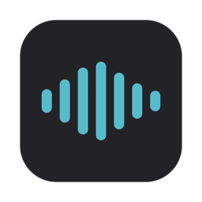
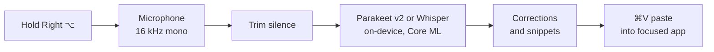

<div align="center">



# Echo

**Hold a key, speak, release. Your words appear wherever you are typing.**

Free, on-device dictation for macOS. A subscription-free alternative to Wispr Flow.

[](https://github.com/michaelmjhhhh/Echos/releases/latest)


[](LICENSE)

[Download](https://github.com/michaelmjhhhh/Echos/releases/latest) · [How it works](#how-it-works) · [Build from source](#build-from-source) · [Changelog](CHANGELOG.md)

</div>

---

## Why Echo

- **Fast.** Parakeet v2 runs on the Apple Neural Engine. In synthetic replay on an M4, a short phrase came back in about 0.04 s after the key was released.
- **Private.** Audio never leaves your Mac. There are no accounts, no telemetry and no network calls during dictation. The only download is the speech model.
- **Works everywhere.** Text is pasted into the focused app, so native, Electron and browser apps all work.
- **Free.** MIT licensed, with no subscription and no usage limits.

## Features

| | |
|---|---|
| **Hold-to-talk** | Hold Right ⌥, Right ⌘ or Fn, speak, then release. |
| **Choice of models** | Parakeet v2 is the default. Six Whisper models are also available, including multilingual Large v3. |
| **Dictionary** | Teach Echo names and terms, and fix words it keeps getting wrong. |
| **Snippets** | Say a trigger phrase and Echo inserts saved text, such as an email address, a link or a prompt. |
| **History** | Search, copy and reopen past transcripts. |
| **Insights** | Words dictated, words per minute and an activity calendar. Everything is stored locally. |

## Install

1. Download `Echo-vX.Y.Z.dmg` from the [latest release](https://github.com/michaelmjhhhh/Echos/releases/latest), open it, and drag **Echo** to **Applications**.
2. Releases are ad-hoc signed and **not notarized**. If macOS blocks the app, remove the quarantine flag once:

   ```sh
   xattr -dr com.apple.quarantine /Applications/Echo.app
   ```

3. Launch Echo and grant **Microphone** and **Accessibility** access. The menu bar icon links to the right Settings panes.
4. Wait for the one-time model download (about 465 MB). Progress is shown in the menu.
5. Hold **Right ⌥** and talk.

> [!NOTE]
> Echo requires an Apple Silicon Mac running macOS 14 or later.

## Models

Switch models in **Settings → Model**. Each model downloads on demand.

| Model | Size | Best for |
|---|---|---|
| **Parakeet v2 (English)** · *default* | ~465 MB | Lowest latency and strong English accuracy |
| Tiny / Base / Small (English) | 75–485 MB | Smaller Whisper models |
| Distil Large v3 | 594 MB | Whisper with dictionary hints |
| Large v3 Turbo / Large v3 | 626–947 MB | Languages other than English |

Whisper pads every recording to a 30-second window, so even a one-word clip pays the full encoder cost. Parakeet avoids most of that wait. It takes no text prompt, so dictionary hints and recent-context biasing apply only to Whisper models. Saved spelling corrections and snippets work with every model.

## How it works



- **Insertion uses the clipboard.** Pasting is the only method that works reliably across native, Electron and browser apps. By default the transcript stays on the clipboard so you can paste it again. Turn off **Copy transcript to clipboard** to restore your previous clipboard after each paste. When a password field has focus and that setting is off, Echo shows a Copy button instead of pasting.
- **Text processing is a pipeline.** Raw transcript text passes through cleanup, spelling corrections and snippet expansion before it is inserted. This pipeline is also where a future local-LLM formatting step would go.
- **Long recordings are split at pauses** so each piece is decoded in a single model window.

## Build from source

Requirements: Apple Silicon, macOS 14+, Xcode 16+, and [XcodeGen](https://github.com/yonaskolb/XcodeGen) (`brew install xcodegen`).

```sh
xcodegen generate
xcodebuild -scheme Echo -configuration Release -derivedDataPath build \
  CODE_SIGN_IDENTITY=- CODE_SIGNING_REQUIRED=NO build
open build/Build/Products/Release/Echo.app
```

With ad-hoc signing (`CODE_SIGN_IDENTITY=-`), macOS may ask you to grant Accessibility again after each rebuild. To avoid that, sign with your own development certificate.

Run the tests:

```sh
xcodebuild -scheme Echo test
```

`EchoEvaluate` replays audio against any model to compare latency and accuracy. See [docs/evaluation.md](docs/evaluation.md).

## Acknowledgements

- [FluidAudio](https://github.com/FluidInference/FluidAudio): Parakeet on Core ML
- [WhisperKit](https://github.com/argmaxinc/argmax-oss-swift): Whisper on Core ML
- [NVIDIA Parakeet TDT 0.6B v2](https://huggingface.co/nvidia/parakeet-tdt-0.6b-v2) and [OpenAI Whisper](https://github.com/openai/whisper)

## License

[MIT](LICENSE)
